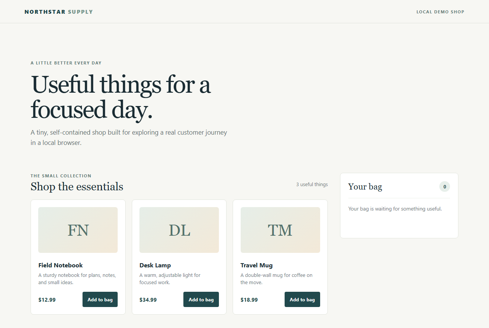
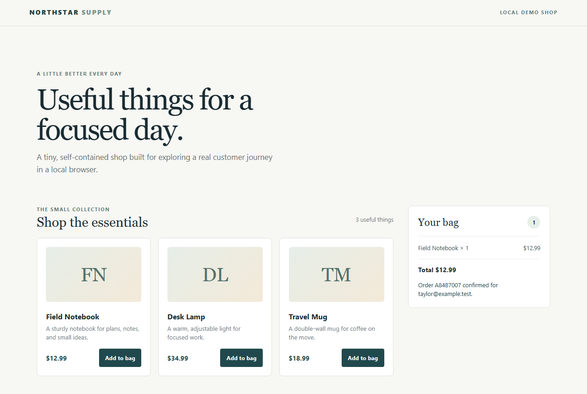

# WebdriverIO + TypeScript Automation Framework

[](https://github.com/niranjankagri/webdriverio-typescript-framework/actions/workflows/ci.yml)

A portfolio-ready browser automation framework built with WebdriverIO, TypeScript, and a local demo shop. It demonstrates maintainable page and component objects, isolated test data, cross-browser execution, network mocking, useful failure diagnostics, and API contract checks.

| The demo shop | After a confirmed order |
|---|---|
|  |  |

## What’s included

- A deterministic demo shop with product and order APIs.
- 10 browser tests (catalogue, bag, checkout, validation, failure handling) written with Mocha, a page object and component objects.
- Chrome and Firefox support, including headless runs; CI runs both.
- Network mocking with `browser.mock` (WebDriver BiDi) to test what the shop does when its API fails.
- Fast HTTP route tests using Node’s built-in test runner.
- JUnit and Allure reports, with sanitized failure details and screenshots when available.
- Optional Karate API contracts and Stryker mutation testing for diagnostic redaction.
- A quality catalog that maps every test case to a requirement for Quality Intelligence imports.

## Design

| Pattern | Where | Why |
|---|---|---|
| Page object | `test/pages/StorePage.ts` | The one page of the shop; specs start from `await new StorePage().open()` |
| Component objects | `test/components/` (`ProductList`, `CartPanel`, `CheckoutForm`) | Each part of the page owns its locators; specs never contain selectors |
| Test data | `test/support/customers.ts`, `test/support/products.ts` | Unique customers per test; the expected catalogue kept apart from the app's own data |
| Browser checks | `test/support/browser-checks.ts` | Network and console checks (order request status, JavaScript errors) and the API failure mock, out of the specs |
| API helper | `test/support/shop-api.ts` | Reads a stored order through the API to check what the page confirmed |
| Failure diagnostics | `test/support/failure-diagnostics.ts`, `wdio.conf.ts` | Screenshot and sanitized `run.json` for every failing test, attached to Allure |

**[Architecture overview](docs/architecture.md):** a diagram of the layers (runner, WebdriverIO hooks, specs, page and components, test data and helpers, demo shop, artifacts) and one test, TC-107, annotated line by line to show page objects, test data, the API helper and the automatic failure diagnostics working together.

## Test cases

| ID | Test | Tag |
|---|---|---|
| TC-101 | The shop page loads | smoke |
| TC-102 | A customer completes checkout and sees the confirmation | regression |
| TC-103 | The catalogue lists every product with its price | smoke |
| TC-104 | The bag adds up lines, item count and total for several products | regression |
| TC-105 | The bag starts empty, without a checkout form or total | smoke |
| TC-106 | The one-item-per-order rule is explained and no order is sent | regression |
| TC-107 | The confirmed order is stored on the server (checked through the API) | regression |
| TC-108 | A failing catalogue request is reported to the customer (`browser.mock`) | regression |
| TC-109 | The server's rejection of an order is shown with its reason | regression |
| TC-110 | An order the browser's form validation rejects is not sent | regression |

API cases TC-201 to TC-210 (`test/demo/server.test.ts`, the Karate feature shares TC-202, 203, 205 and 207).
Every case is written out for manual runs, with preconditions, test data, steps and expected
results, in **[docs/manual-test-cases.md](docs/manual-test-cases.md)**; each automated test carries
its case ID in its name.

## Requirements

- Node.js 22.19 or newer and npm.
- Chrome for the default test run; Firefox is also required for cross-browser runs.
- Java 17 and Maven only if you want to run the optional Karate suite.

## Run the browser tests

Install dependencies and run the complete WebdriverIO suite:

```sh
npm ci
npm test
```

The test runner starts the demo shop on an available local port, waits for its health endpoint, runs the tests, and stops the server. The default run uses Chrome.

```sh
npm run test:smoke          # Page, catalogue and empty-bag checks
npm run test:regression     # Bag, checkout, validation and failure handling
npm run test:headless       # Chrome in headless mode
npm run test:cross-browser  # Chrome and Firefox
npm run test:api            # Demo shop HTTP routes; no browser or Maven required
npm run typecheck           # TypeScript validation
npm run test:unit           # Diagnostic sanitization, JUnit merge and summary checks
npm run test:failure-demo   # One test that fails on purpose, to see the failure evidence
```

### Chrome and Firefox on your machine

WebdriverIO uses the browsers installed on the machine and downloads the matching driver (chromedriver, geckodriver) by itself on the first run; nothing else needs installing.

| Goal | Command |
|---|---|
| Chrome, with a visible window (default) | `npm test` |
| Chrome, headless | `npm run test:headless` |
| Firefox only | `node ./scripts/run-tests.mjs --browsers firefox` (add `--headless` for no window) |
| Both, one after the other | `npm run test:cross-browser` |
| A category in both | `node ./scripts/run-tests.mjs smoke --browsers chrome,firefox` |
| The same as CI | `npm run test:headless -- --browsers chrome` and `... --browsers firefox` |

- Firefox must be installed for the Firefox runs (`winget install Mozilla.Firefox`, `brew install --cask firefox`, or the distribution's package). A missing browser fails at session start with "unable to find binary"; the Chrome runs are unaffected.
- Each browser gets its own JUnit file: `artifacts/test-results/results-chrome.xml`, `results-firefox.xml`.
- For restricted local environments where headless Chrome cannot create sandboxed processes, set `CHROME_NO_SANDBOX=true`. This option disables Chrome’s sandbox and is intended only for trusted local test content.

### When a test fails

`npm run test:failure-demo` runs one test that expects a message the shop never shows, so you can see all of this without breaking anything. A failed run leaves:

| Where | What |
|---|---|
| Terminal | The assertion (`Expected: "Thank you, your parcel is on its way!"` / `Received: "Order 388C4099 confirmed for …"`) and the line `Failure evidence saved to artifacts/failures/<time>-<test>-<browser>` |
| `artifacts/failures/<time>-<test>-<browser>/screenshot.png` | The page at the moment of the failure |
| `artifacts/failures/…/run.json` | Test, browser and version, page URL, the error, and summaries of console messages and network requests (method, URL, status); e-mail addresses and credentials redacted, no bodies, headers or cookies |
| `artifacts/test-results/results-<browser>.xml` | The JUnit failure with its message, for CI tools and Quality Intelligence |
| `artifacts/allure-results/` | The same test in Allure, with the screenshot and `run.json` attached |
| CI | A summary on the job page (totals, and each failure's expected vs. received) and the artifacts `junit-<browser>` and `evidence-<browser>` (Allure results, screenshots and `run.json`) |

`node scripts/junit-summary.mjs` prints the same summary locally.

To run the demo shop manually, use `npm run demo`. It listens on `127.0.0.1:4173` by default; set `PORT` to change the port. Set `BASE_URL` to run WebdriverIO against an already-running compatible shop.

## API contracts

The optional Karate suite checks catalog responses, order creation and readback, invalid-order handling, and that an oversized order is refused with 413 Payload Too Large. Start the demo shop in one terminal, then run the API suite in another:

```sh
npm run demo
npm run test:karate
```

The suite defaults to `http://127.0.0.1:4173`; set `BASE_URL` to target another compatible service. Karate writes its HTML report under `api-tests/karate/target/karate-reports/`.

## Reports and diagnostics

Each WebdriverIO run writes one JUnit XML file per browser, `artifacts/test-results/results-<browser>.xml`, and Allure result files under `artifacts/allure-results/`. (WebdriverIO's reporter writes one file per spec worker; `scripts/merge-junit.mjs` combines them after the run, so tools that read one file as one run see the whole run, and removes the files of earlier runs before a new one.) Allure results include stable test IDs and browser and Node.js metadata. If a test fails, the framework attempts to save a screenshot and a sanitized `run.json` under `artifacts/failures/`.

The failure manifest can include the test name, browser and version, page URL, error, and summaries of browser-console and network events. It omits request and response bodies, headers, and cookies; common credential fields and email addresses are redacted. The manifest also records when WebDriver BiDi log or network capture is unavailable.

If the Allure CLI is installed, generate a browsable report with:

```sh
allure generate artifacts/allure-results --clean -o artifacts/allure-report
```

## Mutation checks

Run Stryker against the diagnostic sanitizers:

```sh
npm run test:mutation
```

The run requires a 75% minimum mutation score and writes HTML and JSON reports under `artifacts/mutation/`.

## CI

GitHub Actions (`.github/workflows/ci.yml`) runs on every pull request and push to `main`, by hand, and every Monday night:

| Job | What it runs |
|---|---|
| Typecheck, unit and API tests | `tsc --noEmit`, the unit tests (diagnostics, JUnit merge) and the demo-shop API tests |
| Karate API contracts | Starts the demo shop and runs the Karate suite (report kept as an artifact) |
| Browser tests (chrome, firefox) | `npm run test:headless -- --browsers <browser>`; a test summary on the job page; artifacts `junit-<browser>` and `evidence-<browser>` (Allure results, failure screenshots and `run.json`) |

Dependabot proposes npm, Maven and GitHub Actions updates once a month (`.github/dependabot.yml`).

## Quality Intelligence

`quality/catalog.toml` maps all 10 tests (TC-101 to TC-110) to five demo-shop requirements. WebdriverIO's JUnit reporter writes a title like `[TC-101] [smoke] displays the local shop` as `TC 101 smoke displays the local shop`, so the catalogue matches `*::TC 101 *`. A local run gives 100 % requirement coverage and 10 of 10 matched results. To import a local run into [Automation Coverage & Quality Intelligence](https://github.com/niranjankagri/automation-coverage-quality-intelligence), run these commands from that repository. Replace `/path/to/webdriverio-typescript-framework` with this checkout’s path:

```sh
qi history import /path/to/webdriverio-typescript-framework/artifacts/test-results \
  --catalog /path/to/webdriverio-typescript-framework/quality/catalog.toml
qi dashboard --catalog /path/to/webdriverio-typescript-framework/quality/catalog.toml
```

## Project layout

```text
api-tests/karate/       Optional API contract suite
quality/                Test-to-requirement catalog
scripts/                Local WebdriverIO runner, JUnit merge and summary
src/demo/               Demo shop and static assets
test/pages/             Page object
test/components/        Component objects: product list, bag, checkout form
test/specs/             End-to-end scenarios: catalog, cart, checkout
test/support/           Test data, browser checks, API helper, failure diagnostics
test/failure-demo/      A test that fails on purpose (npm run test:failure-demo; not in CI)
test/scripts/           Unit tests for the scripts
docs/                   Architecture overview, README screenshots
artifacts/              Generated reports and failure evidence
```
