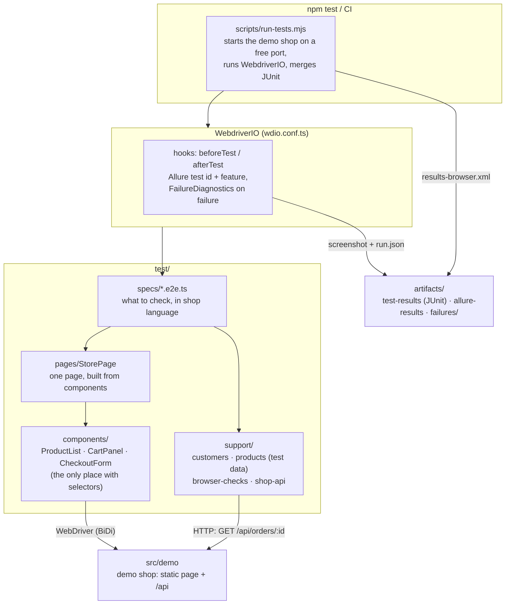

# Architecture

How the pieces fit together, and one test that uses all of them.

## The layers



| Layer | Knows about | Does not know about |
|---|---|---|
| Spec | the shop's behaviour ("the bag adds up lines") | selectors, HTTP, report formats |
| Page / components | the page's structure (selectors, data-testid hooks) | what a test expects |
| Test data | customers, the expected catalogue | the page |
| Browser checks / API helper | network events, console logs, the API | the page's structure |
| Hooks + FailureDiagnostics | every test, automatically | any particular test |

Rules kept by every spec: no selectors, no `browser.execute`, no raw `fetch`; one new customer per test; IDs in the title (`[TC-107]`) for Allure and Quality Intelligence.

## One test, all the pieces

`test/specs/checkout.e2e.ts`, TC-107: the order the page confirms must really be stored.

```ts
let store: StorePage

beforeEach(async () => {
  store = await new StorePage().open()             // page object: opens the shop, returns itself
})

it('[TC-107] [regression] stores the confirmed order on the server', async () => {
  const customer = createTestCustomer()             // test data: a unique name and e-mail per run

  await store.products.addToBag(FIELD_NOTEBOOK.id)  // component: ProductList owns the "Add to bag" locator
  await store.checkout.placeOrder(customer)         // component: CheckoutForm fills the form and submits
  await expect(store.message).toHaveText(expect.stringContaining('confirmed'))

  const orderId = /Order (\w+) confirmed/.exec(await store.message.getText())?.[1]
  const order = await getOrder(orderId as string)   // API helper: reads the order back over HTTP

  expect(order).toMatchObject({                      // the server stored what the shopper entered
    productId: FIELD_NOTEBOOK.id, customerName: customer.name, email: customer.email, totalCents: 1299,
  })
})
```

What happens around it without a line in the test:

| When | What | Where |
|---|---|---|
| Before the test | Allure gets the test id `TC-107` and the feature "the local shop checkout"; the console and network capture is reset | `wdio.conf.ts` `beforeTest` |
| During the test | Every console message and request/response is summarised in memory (WebDriver BiDi) | `FailureDiagnostics` |
| If it fails | A screenshot and a sanitized `run.json` (error, browser, URL, console and network summaries; e-mails and credentials redacted) under `artifacts/failures/<time>-<test>-<browser>/`, attached to Allure | `wdio.conf.ts` `afterTest` |
| After the run | JUnit files merged into `artifacts/test-results/results-<browser>.xml`; in CI a summary on the job page and the evidence as artifacts | `scripts/merge-junit.mjs`, `scripts/junit-summary.mjs`, `.github/workflows/ci.yml` |

Other specs use the browser checks the same way, e.g. TC-102 ends with
`await waitForOrderResponse(201)` and `await expectNoJavaScriptErrors()`, and TC-108 replaces the
catalogue response with `failProductsRequest()` (`browser.mock`) before opening the page.

To see the failure side for real, run `npm run test:failure-demo` (README, "When a test fails").
